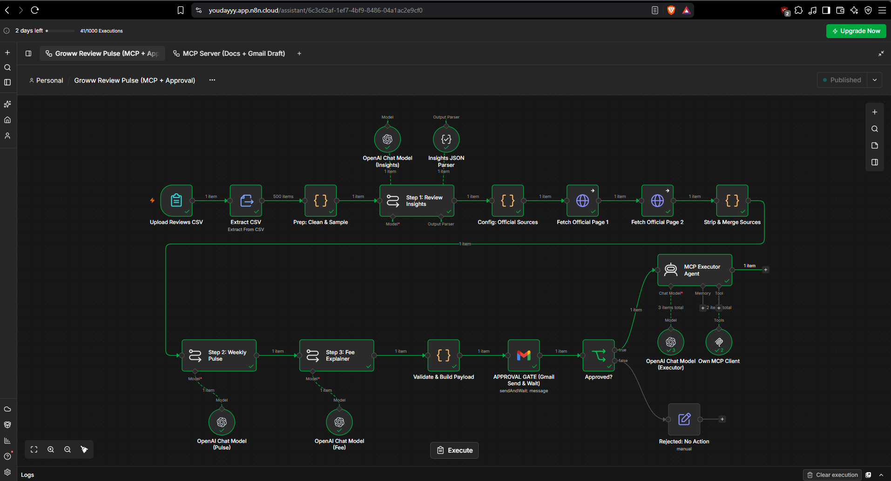
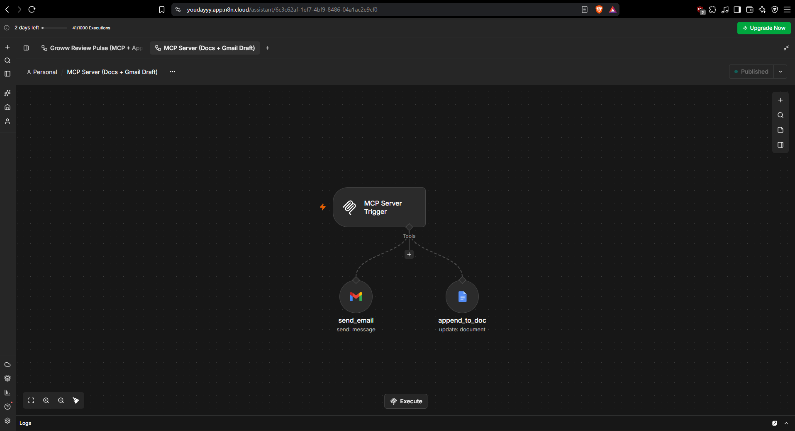
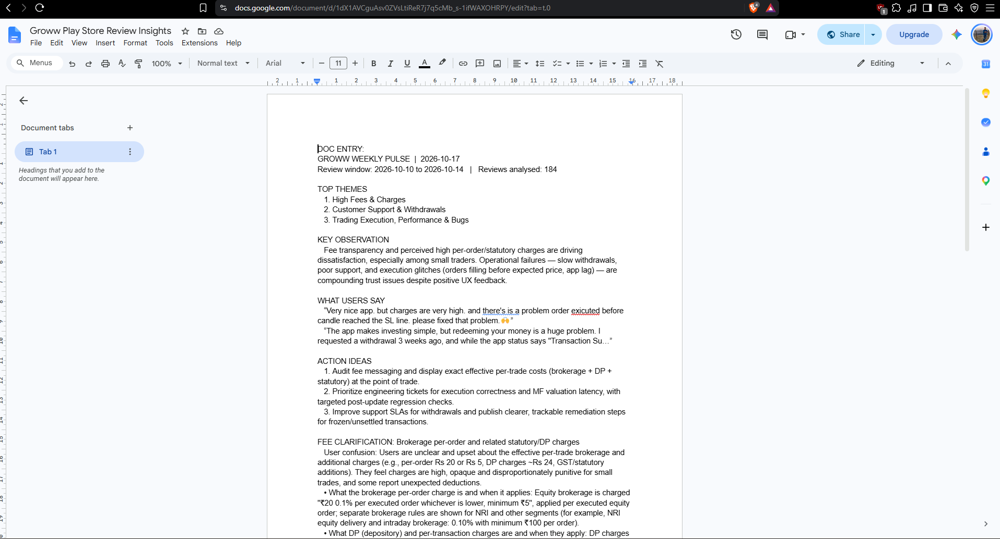

## Screenshots

### 1. n8n Pipeline Workflow

### 2. n8n MCP Server

### 3. Google Doc Entry

## Screenshots

### 1. n8n Pipeline Workflow

### 2. n8n MCP Server

### 3. Google Doc Entry

## How to run

1. Import `workflows/MCP-Server.json` into n8n. Set Google Docs + Gmail credentials and your Doc URL, activate it, and copy the MCP Server Trigger **Production URL**.
2. Import `workflows/Review-Pulse-Pipeline.json`. Paste that URL into `Own MCP Client`. Add your OpenAI credential on the model nodes and your email on the approval node.
3. In `Config: Official Sources`, set the 2 official source URLs for the fee.
4. Open the form (`Upload Reviews CSV`), upload a Groww reviews CSV (a sample is in `data/reviews_sample.csv`), and run.
5. Check your inbox, click **Approve & Log**, then check the Google Doc and your inbox for the summary email.

## Repo contents

| Path | What |
|---|---|
| `workflows/` | n8n workflow JSONs (credentials removed) |
| `data/reviews_sample.csv` | 50-row sample of the reviews CSV |
| `outputs/weekly_pulse.md` | Generated weekly pulse |
| `outputs/fee_explainer.md` | Generated fee explainer |
| `outputs/doc_entry.txt` | Entry appended to the Google Doc |
| `outputs/email.txt` | Email text |

## Limitations

- The original brief asks for an email *draft* with no auto-send. This version sends the email, but only after the human approval step. To get draft-only behaviour, set the Gmail tool in the MCP Server to Resource: Draft, Operation: Create.
- The CSV covers only Oct 10–14, 2026 (5 days), not 8–12 weeks.
- Themes come from an LLM over a sample of up to 160 reviews, so counts are approximate.
- The fee explainer uses only text fetched from the official pages. Recheck the links when the "Last checked" date gets old.
- Reviews are public Google Play reviews.
